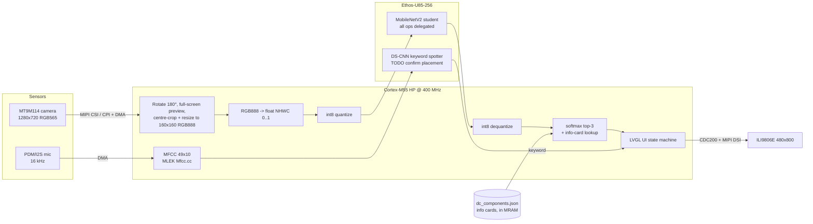
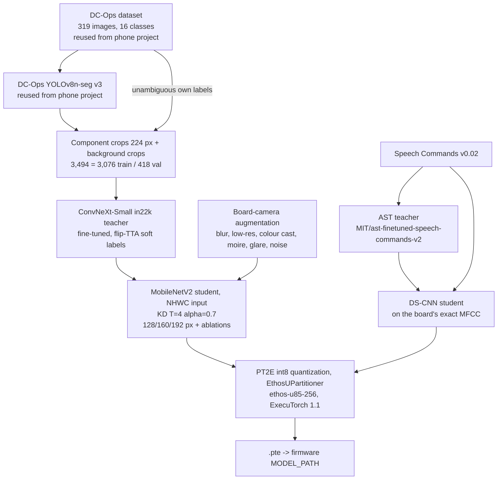

# DC-Ops on E8: architecture

`TODO(...)` marks anything not yet measured or not yet in the judged build.

## 1. On-device pipeline

Placement rationale: the dense conv graphs go to the NPU. The camera geometry, softmax, UI and
int8 boundary stay on the M55. On the measured BlazeFace build, NPU inference is 4.61 ms out of a
166 ms frame, about 3.4%. The frame rate is set by the camera, preview and LVGL work on the M55,
not by the model. The M55 HE + Ethos-U55 is free and is the planned home for an always-on KWS.
It is not built.

## 2. Training and distillation pipeline

Scripts: `dcops/jobs/{teacher,student,kws}.py`, `dcops/export/{export_student,export_kws}.py`,
`dcops/export/watch_overnight.sh` (pulls results, exports them, rewrites `dcops/REPORT.md`).

Teacher crops per class: server rack 141, compute tray 351, NVLink switch tray 0, network switch 0,
power shelf 245, cable 26, network port 702, LED indicator 148, label 66, fan 77, cooling manifold 31,
cable cartridge 0, power connector 5, drive bay 759, management port 0, DPU 30, background 913.

## 3. Memory map (M55 HP image)

Figures are from the ELF of the validated classifier build
(`build-classify`, MobileNetV2 160 px, 67-class ImageNet subset, `ACTIVATION_BUF_SZ=0x180000`).
The DC-Ops student build replaces the .pte. Its numbers are `TODO(measure)`.

### MRAM (5.5 MB total; HP app partition 0x80200000–0x80580000 = 3.5 MiB)

| Range | Contents | Size |
|---|---|---|
| 0x80200000–0x802AA71C | startup + code | 698 KB |
| 0x802AA720– | ITCM code image (copied at boot) | 167 KB |
| 0x802D3280– | DTCM `.data` image | 7 KB |
| 0x802D4F80–0x8052A054 | read-only data, mainly the `.pte` (2,408,512 B) | 2,445 KB |
| **image end 0x8052A054** | **3.16 MiB used** | |
| 0x8052A054–0x80578000 | headroom to the guard limit | **312 KB** |
| 0x80578000 | guard limit in `scripts/alif/flash_e8_hp.sh` | |
| 0x8057BC00–0x80580000 | **Alif ATOC boot table + stubs. Never overwrite.** | ~17 KB |

> An oversized image links fine and flashes fine, but it overwrites the ATOC and the HP core
> stops booting. We hit this and recovered by writing an MRAM backup through the HE core
> (the backup and restore script are outside this repo, in `../board-backups/`; the stock `restore.sh` there connects as the HP core, so it needs adapting for an HE-side restore). The flash script now refuses any image that ends past 0x80578000.

Budget for the next model: about 2.6 MB (2,352 KB + 312 KB) of .pte at most, with the current code size.

### SRAM (9.75 MB on chip)

| Section | Address | Size | Contents |
|---|---|---|---|
| `.bss.sram` | 0x02000000 | 7,191,760 B (6.86 MiB) | camera frame buffers, full-screen preview, LVGL, ExecuTorch arena 1.5 MiB (0x180000) |
| `.bss.unstriped` | 0x02700000 | 768,000 B | display framebuffer (480x800 RGB565) |
| ITCM | 0x01000000 | 167 KB | hot code |
| DTCM | 0x20000000 | data 7 KB, `.bss` 30 KB, non-secure region 140 KB, heap 92 KB, stack 32 KB | |

KWS: the model and arena sizes are `TODO(measure)`. The DS-CNN is tens of thousands of params,
so the expected footprint is tens of KB of MRAM.
