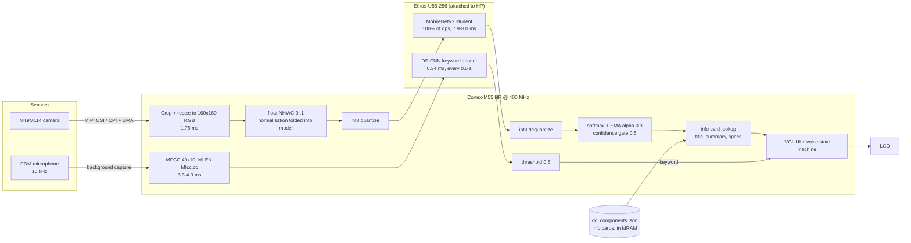
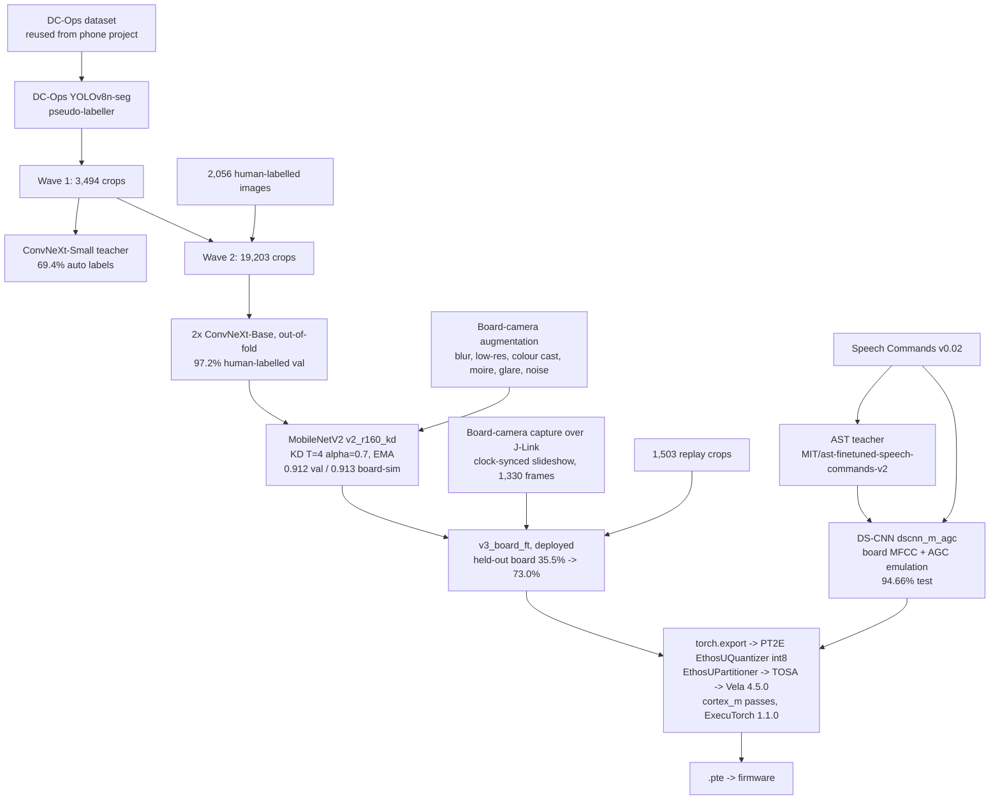

# DCSM-Simplified: architecture

`TODO(measure)` marks anything not yet measured.

## 1. On-device pipeline (one HP image, `build-fusion`)

Two ExecuTorch 1.1.0 programs share one runtime. MLEK's `EtModel` was changed from a static
method to a per-instance method (`source/lib/mlek/fwk/executorch/EtModel.cc/.hpp`) so both can be
loaded at once.

### Workload placement

| Workload | Runs on | Measured |
|---|---|---|
| Camera capture | MIPI CSI + CPI + DMA | dominates the frame with LCD/LVGL |
| Crop / resize, float NHWC | M55 HP | 1.75 ms |
| int8 quantize / dequantize | M55 HP | only CPU ops in either graph |
| Vision classifier | Ethos-U85-256 | 7.9–8.0 ms |
| Softmax, EMA, gate, info card | M55 HP | trivial |
| MFCC 49x10 | M55 HP | 3.3–4.0 ms |
| Keyword spotter | Ethos-U85-256 | 0.34 ms, 2 strides/s |
| HE core (M55 + Ethos-U55) | unused | next step: always-on KWS, not built |

Full frame: 255–287 ms (3.5–3.9 FPS; LCD footer 274 ms / 3.6 FPS), measured with the earlier v2
vision model (same architecture). The NPU was about 3% of the 274 ms frame and is about 6% of the 124 ms frame now. Camera capture, LCD/LVGL and
per-frame UART logging dominate. Per-frame UART printing has since been removed from the classify
path; after that change: frame 124 ms, 8.0 FPS on the LCD footer (was 274 ms, 3.6 FPS): 2.2x faster.

### Voice workflow

| Keyword | Action |
|---|---|
| `go` (or `yes` / `on`) | Latch the identified part, open its inspection checklist; live label freezes. Only accepted when vision has a confident identification. |
| `go` / `on` / `right` while holding | Next knowledge page: specs, troubleshooting, LED status, maintenance. `left` goes back. |
| `yes` | Mark selected item pass, advance. |
| `no` | Mark fail, advance. On item 1 ("is this the right part?") reject the identification and return to scanning. |
| `up` / `down` | Move cursor. |
| `stop` | Back to live scanning. |

The model knows 10 words (yes no up down left right on off go stop) plus `_silence_` and
`_unknown_`; the UI uses 6. Vision decides *what*; voice confirms and drives the workflow.

### Demo class mask

`CLS_ALLOWED_MASK` (in `usecase.cmake`, default all) limits which classes may be shown. The demo
build uses `0x13250`: power shelf, network port, fan, power connector, drive bay (+ background).

## 2. Training and distillation pipeline

Scripts: `dcops/jobs/{teacher,teacher_v2,student,kws,finetune_board}.py`,
`dcops/export/{export_student,export_kws}.py`. Notebooks: `dcops/colab/` (incl.
`dcops_board_ft.ipynb`). Board capture tools: `dcops/board_capture/` (`capture.py` clock mode,
`build_ft_data.py`, `build_deck2.py`). All training ran on Colab GPUs.

Vela: `ethos-u85-256`, `Ethos_U85_SRAM_MRAM`, `Shared_Sram`. ExecuTorch 1.1 lowers
conv -> permute -> reshape into cancelling transposes that Vela miscompiles; the student uses an
NPU-friendly head (AvgPool + reshape + Linear on NHWC) to avoid it. See `docs/blazeface-vela-bug.md`.

## 3. Memory map (M55 HP image)

### build-fusion (deployed)

| Item | Value |
|---|---|
| Image end | 0x805473C4 |
| Guard limit (`scripts/alif/flash_e8_hp.sh`) | 0x80578000 |
| Headroom | ~195 KB |
| Vision .pte | 2301 KB |
| KWS .pte | 93 KB |
| KWS activation buffer | 0x20000 (128 KB) |
| Alif ATOC boot table | 0x8057BC00. Never overwrite. |

### Earlier validation build (for the section breakdown)

Figures from the ELF of `build-classify` (MobileNetV2 160 px, 67-class ImageNet subset,
`ACTIVATION_BUF_SZ=0x180000`).

MRAM (5.5 MB total; HP app partition 0x80200000–0x80580000 = 3.5 MiB):

| Range | Contents | Size |
|---|---|---|
| 0x80200000–0x802AA71C | startup + code | 698 KB |
| 0x802AA720– | ITCM code image (copied at boot) | 167 KB |
| 0x802D3280– | DTCM `.data` image | 7 KB |
| 0x802D4F80–0x8052A054 | read-only data, mainly the `.pte` (2,408,512 B) | 2,445 KB |
| **image end 0x8052A054** | **3.16 MiB used** | |
| 0x8052A054–0x80578000 | headroom to the guard limit | **312 KB** |
| 0x80578000 | guard limit in `scripts/alif/flash_e8_hp.sh` | |
| 0x8057BC00–0x80580000 | **Alif ATOC boot table + stubs. Never overwrite.** | ~17 KB |

> An oversized image links fine and flashes fine, but it overwrites the ATOC and the HP core
> stops booting. We hit this and recovered by writing an MRAM backup through the HE core
> (J-Link device `AE822FA0E5597LS0_M55_HE`; procedure in `README_SECTION.md`). The flash script
> now refuses any image that ends past 0x80578000.

SRAM (9.75 MB on chip), validation build:

| Section | Address | Size | Contents |
|---|---|---|---|
| `.bss.sram` | 0x02000000 | 7,191,760 B (6.86 MiB) | camera frame buffers, full-screen preview, LVGL, ExecuTorch arena 1.5 MiB (0x180000) |
| `.bss.unstriped` | 0x02700000 | 768,000 B | display framebuffer (480x800 RGB565) |
| ITCM | 0x01000000 | 167 KB | hot code |
| DTCM | 0x20000000 | data 7 KB, `.bss` 30 KB, non-secure region 140 KB, heap 92 KB, stack 32 KB | |
